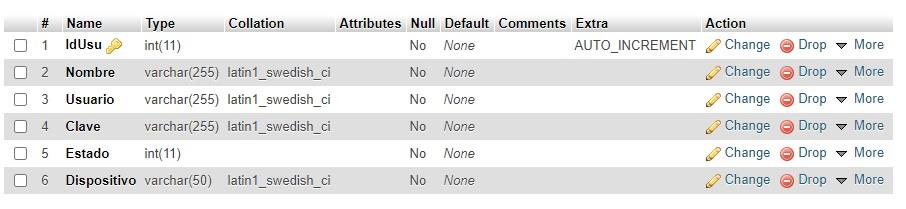
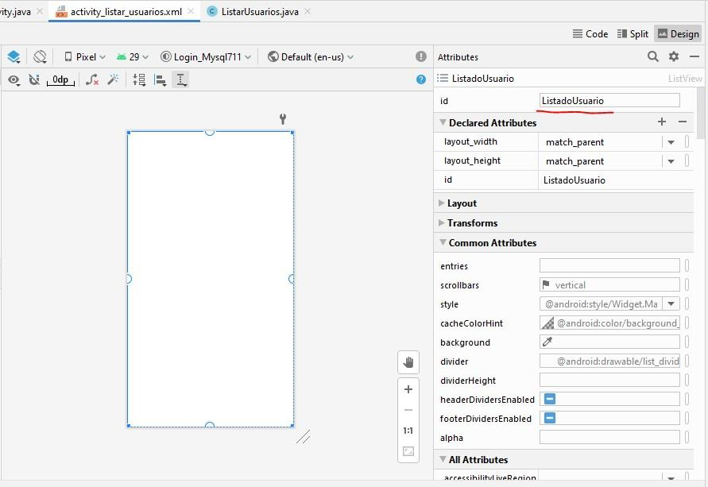
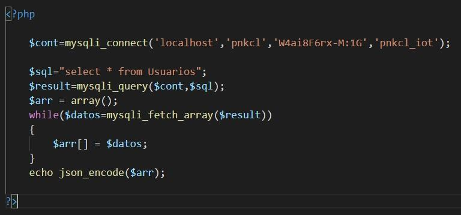
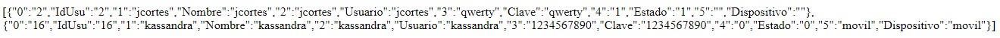
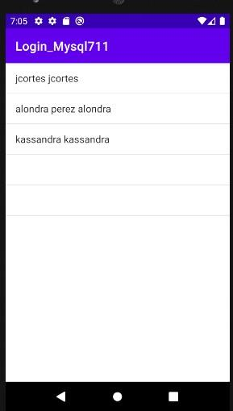

# Cargar Datos desde PHP, MySQL y AWS en Android (ListView)


---

## 1. Requisitos Previos y Entorno

En **AWS** se debe contar con la instancia EC2 activa y con todos los servicios web y de base de datos corriendo (Apache/Nginx, PHP y MySQL/MariaDB) para realizar la carga y visualización de datos.

### Estructura de la Tabla `Usuarios` en MySQL
Los registros que se cargan desde la aplicación Android hacia la base de datos MySQL siguen la siguiente estructura:



### Datos de Ejemplo en la Base de Datos
Para visualizar los datos en la aplicación, se insertan registros de prueba:



---

## 2. Creación del Servicio Web PHP (`consulta.php`)

Se debe crear el archivo `consulta.php` en el servidor web de la instancia AWS. Este script realiza una consulta `SELECT` a la tabla `Usuarios` y retorna los registros en formato JSON.



```php
<?php
$conn = mysqli_connect('localhost', 'root', 'clave', 'pnkcl_iot');
$sql = "SELECT * FROM Usuarios";
$result = mysqli_query($conn, $sql);

$usuarios = array();
while ($row = mysqli_fetch_assoc($result)) {
    $usuarios[] = $row;
}

echo json_encode($usuarios);
mysqli_close($conn);
?>
```

### Respuesta esperada en formato JSON
Al acceder a `http://<IP_INSTANCIA_AWS>/consulta.php`, la respuesta debe ser similar a:



```json
[
  {"id":"1","nombre":"Juan","apellido":"Perez","usuario":"jperez"},
  {"id":"2","nombre":"Maria","apellido":"Gonzalez","usuario":"mgonzalez"}
]
```

---

## 3. Implementación en Android (Kotlin)

El Activity encargado de mostrar los registros en el `ListView` se denominará `ListaUsuarios` (o `ListarUsuarios.kt`).

En el layout XML se define un `ListView` con el ID `ListadoUsuario`.

### 3.1 Declaración y Enlace de Componentes
```kotlin
lateinit var list: ListView 
lateinit var listado: ArrayList<String> 
lateinit var dato: RequestQueue 

override fun onCreate(savedInstanceState: Bundle?) {
    super.onCreate(savedInstanceState)
    setContentView(R.layout.activity_lista_usuarios)

    list = findViewById(R.id.ListadoUsuario)
    dato = Volley.newRequestQueue(this)
    cargaLista()
}
```

### 3.2 Método `cargaLista()` con Volley
```kotlin
private fun cargaLista() { 
    val listaUsu = ArrayList<String>() 
    val url = "http://35.174.239.31/consulta.php" // Reemplazar con la IP elástica de su instancia AWS

    val request = StringRequest(
        Request.Method.GET, 
        url, 
        Response.Listener<String> { response -> 
            try { 
                val json = JSONArray(response) 
                for (i in 0 until json.length()) { 
                    val usuarios = json.getJSONObject(i) 
                    val linea = "${usuarios.getString("nombre")} ${usuarios.getString("usuario")}" 
                    listaUsu.add(linea) 
                } 
                val adapter = ArrayAdapter<String>(
                    this, 
                    android.R.layout.simple_list_item_1, 
                    listaUsu
                ) 
                list.adapter = adapter 
            } catch (e: Exception) { 
                e.printStackTrace() 
            } 
        }, 
        Response.ErrorListener { error -> 
            error.printStackTrace() 
        }
    ) 

    dato.add(request) 
}
```

---

## 4. Resultado Visual

Al ejecutar la aplicación, el `ListView` cargará dinámicamente los datos obtenidos desde la base de datos MySQL en AWS:


