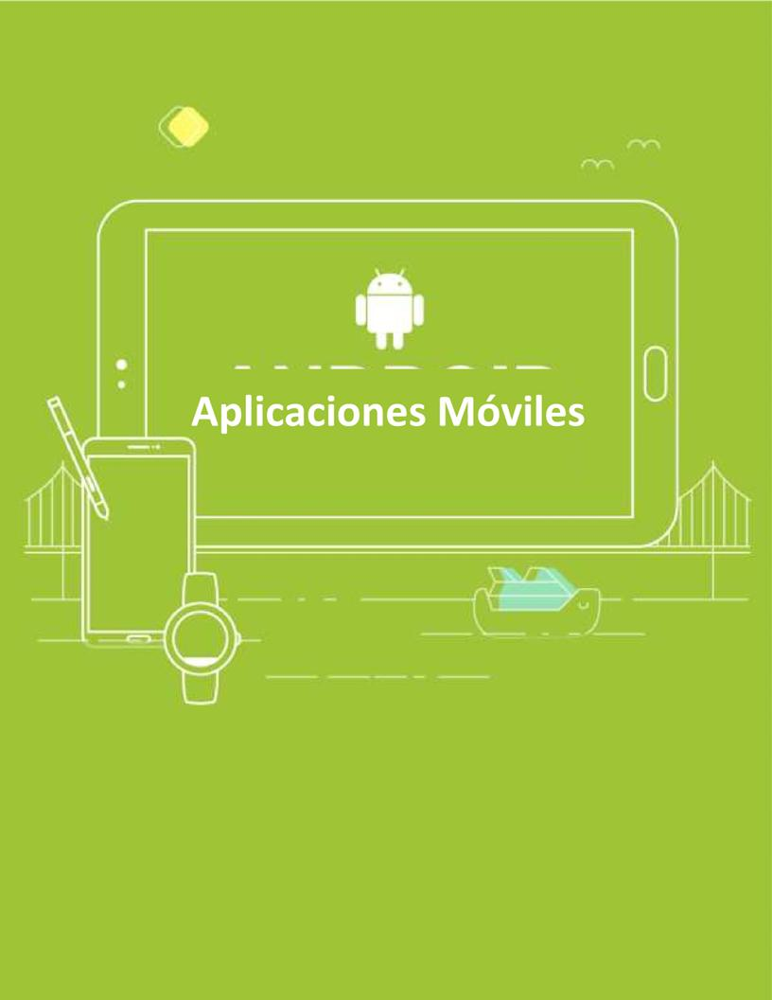
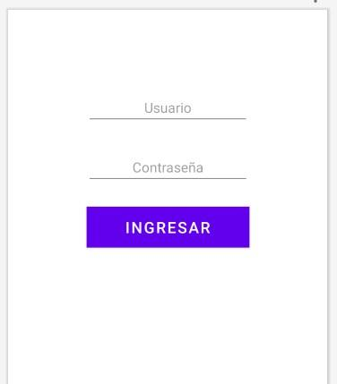
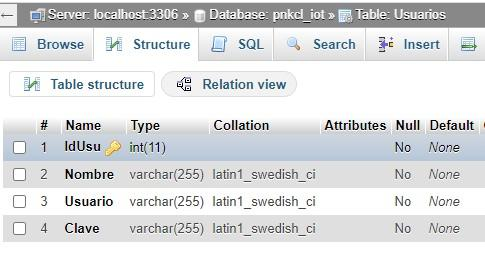

# Consultar Login en Android + AWS + MySQL + PHP



**Autor:** Jorge Cortés Gallardo  
**Materia:** Aplicaciones Móviles

---

## 1. Diseño del Layout de Login

Se diseña un layout simple con los campos necesarios para solicitar el usuario y la contraseña, además del botón para iniciar sesión.



---

## 2. Configuración del Proyecto Android

### 2.1 Permiso de Internet y Tráfico en Texto Claro
En el archivo `AndroidManifest.xml`, agregar el permiso de internet y habilitar `usesCleartextTraffic` si la instancia AWS no utiliza HTTPS:

```xml
<manifest xmlns:android="http://schemas.android.com/apk/res/android" ...>

    <uses-permission android:name="android.permission.INTERNET" />

    <application
        ...
        android:usesCleartextTraffic="true"
        ...>
        ...
    </application>
</manifest>
```

### 2.2 Dependencia de Volley
En el archivo `build.gradle` (Module: app) o `build.gradle.kts`, agregar la librería **Volley**:

```groovy
implementation("com.android.volley:volley:1.2.1")
```

---

## 3. Implementación en Kotlin

Una vez diseñado el layout, se implementa la lógica para enviar las credenciales a la instancia de AWS donde corre la página PHP encargada de validar en MySQL si el usuario existe.

### 3.1 Declaración y Enlace de Vistas
```kotlin
lateinit var usu: EditText 
lateinit var clave: EditText 
lateinit var btn: Button 
lateinit var datos: RequestQueue 

override fun onCreate(savedInstanceState: Bundle?) {
    super.onCreate(savedInstanceState)
    setContentView(R.layout.activity_login)

    usu = findViewById(R.id.usu) 
    clave = findViewById(R.id.cla) 
    btn = findViewById(R.id.button) 

    datos = Volley.newRequestQueue(this) 

    btn.setOnClickListener { 
        consultarDatos(usu.text.toString(), clave.text.toString()) 
    } 
}
```

### 3.2 Función `consultarDatos()`
La función envía el usuario y la clave mediante método `GET` al microservicio en AWS:

```kotlin
fun consultarDatos(usu: String, pass: String) { 
    val url = "http://52.2.255.205/apiconsultausu.php?usu=$usu&pass=$pass" 

    val request = JsonObjectRequest( 
        Request.Method.GET, url, null, 
        { response -> 
            try { 
                val estado = response.getString("estado") 
                if (estado == "0") { 
                    Toast.makeText(this@MainActivity, "Usuario no existe", Toast.LENGTH_LONG).show() 
                } else { 
                    val ventana = Intent(this@MainActivity, Principal::class.java) 
                    startActivity(ventana) 
                } 
            } catch (e: JSONException) { 
                e.printStackTrace() 
            } 
        }, 
        { error -> 
            error.printStackTrace() 
        } 
    ) 

    datos.add(request) 
}
```

---

## 4. Servicio Backend PHP (`apiconsultausu.php`)

Crear el archivo `apiconsultausu.php` en el servidor AWS con la consulta a la base de datos `pnkcl_iot`:



```php
<?php  
$cont = mysqli_connect('localhost', 'root', 'clave', 'pnkcl_iot');   
$sql = "SELECT * FROM Usuarios WHERE Usuario='" . $_GET['usu'] . "' AND Clave='" . $_GET['pass'] . "'";  
$result = mysqli_query($cont, $sql);  
$num = mysqli_num_rows($result);  

$val = array('estado' => ($num == null || $num == 0) ? '0' : (string)$num); 
echo json_encode($val);  
mysqli_close($cont);
?>
```

> **Nota:** Subir el archivo al directorio web de AWS mediante **FileZilla** o SSH (SCP) y verificar que los datos de conexión coincidan con los de la base de datos creada.
