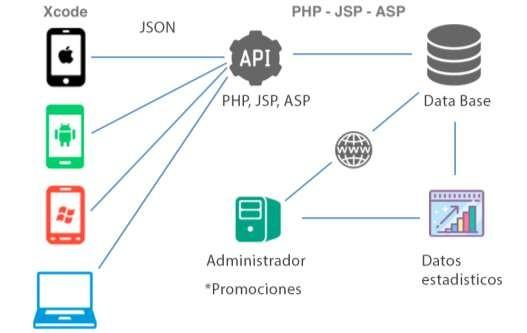
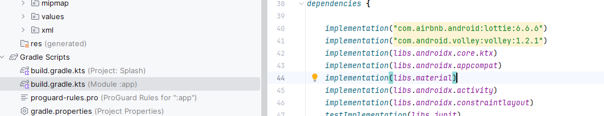
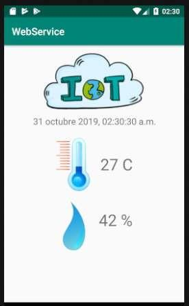
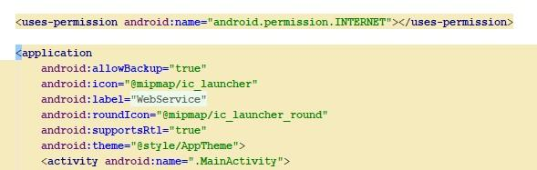
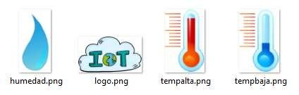
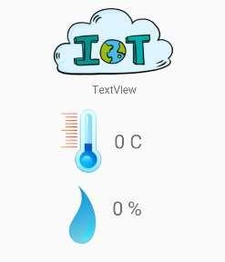
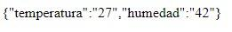
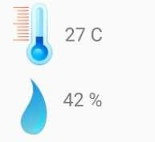
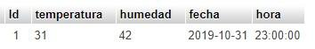
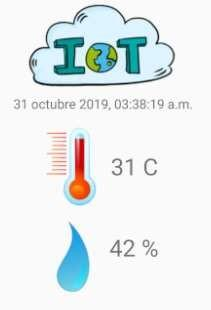

# Consultar WebService en Android con Kotlin (PHP + MySQL + IoT)


**Unidad N° 2:** Desarrollo de Aplicaciones en Android  
**Autor:** Jorge Cortés Gallardo  
**Sede:** La Serena  

---

## 1. Concepto de WebService

Un **WebService** es un conjunto de protocolos y estándares que sirven para intercambiar datos entre aplicaciones independientes de su lenguaje o plataforma. Al apoyarse en HTTP y formatos ligeros como JSON, permiten integrar servicios remotos fácilmente, atravesar firewalls y asegurar interoperabilidad total.

---

## 2. Objetivo de la Aplicación

Construir una aplicación móvil que consulte y muestre en tiempo real las lecturas de **temperatura y humedad** obtenidas desde un WebService creado en PHP y MySQL:



---

## 3. Configuración del Proyecto en Android Studio

### 3.1 Incorporación de la Librería Volley
En `Gradle Scripts -> build.gradle (Module: app)`:

```groovy
implementation("com.android.volley:volley:1.2.1")
```



Hacer clic en **Sync Now**:


### 3.2 Permisos en `AndroidManifest.xml`
Para consultar servicios en Internet se debe agregar el permiso:

```xml
<uses-permission android:name="android.permission.INTERNET" />
```


---

## 4. Diseño del Layout y Recursos Gráficos

### 4.1 Diseño de la Interfaz
Layout inicial de la aplicación:




### 4.2 Recursos en `res/drawable`
Copiar los recursos gráficos correspondientes a los termómetros y estados a `res/drawable`:



### 4.3 Componentes e Identificadores (IDs)
Estructura de componentes en el XML:



| Componente | ID | Descripción |
|---|---|---|
| `TextView` | `txt_fecha` | Muestra fecha y hora del dispositivo |
| `TextView` | `txt_temp` | Muestra la temperatura en °C |
| `TextView` | `txt_humedad` | Muestra la humedad en % |
| `ImageView` | `imagen_temp` | Muestra icono de temperatura alta/baja |

---

## 5. Implementación en Kotlin

### 5.1 Declaración y Enlace de Vistas
```kotlin
lateinit var fecha: TextView 
lateinit var temp: android.widget.TextView 
lateinit var hum: android.widget.TextView 
lateinit var imagenTemp: ImageView 
lateinit var datos: RequestQueue 
val mHandler = Handler(Looper.getMainLooper())

override fun onCreate(savedInstanceState: Bundle?) {
    super.onCreate(savedInstanceState)
    setContentView(R.layout.activity_main)

    fecha = findViewById(R.id.txt_fecha) 
    temp = findViewById(R.id.txt_temp) 
    hum = findViewById(R.id.txt_humedad) 
    imagenTemp = findViewById(R.id.imagen_temp) 

    datos = Volley.newRequestQueue(this)
}
```

### 5.2 Función para Formato de Fecha y Hora
```kotlin
fun fechahora(): String { 
    val c: Calendar = Calendar.getInstance() 
    val sdf = SimpleDateFormat("dd MMMM YYYY, hh:mm:ss a") 
    return sdf.format(c.time) 
}
```

Resultado visual de la fecha y hora:


---

## 6. Consumo del WebService con Volley

El WebService se encuentra en: `https://www.pnk.cl/muestra_datos.php`.

### Respuesta JSON:


```json
{"temperatura":"24.5","humedad":"60"}
```

### 6.1 Método `obtenerDatos()` y Cambio Dinámico de Imagen
```kotlin
private fun obtenerDatos() { 
    val url = "https://www.pnk.cl/muestra_datos.php" 

    val request = JsonObjectRequest( 
        Request.Method.GET, url, null, 
        { response: JSONObject -> 
            try { 
                val tempStr = response.getString("temperatura")
                val humStr = response.getString("humedad")

                temp.text = "$tempStr °C" 
                hum.text = "$humStr %" 

                val valor = tempStr.toFloat() 
                cambiarImagen(valor) 
            } catch (e: JSONException) { 
                e.printStackTrace() 
            } 
        }, 
        { error: VolleyError -> 
            error.printStackTrace() 
        } 
    ) 
    datos.add(request) 
}

private fun cambiarImagen(valor: Float) { 
    if (valor >= 30) { 
        imagenTemp.setImageResource(R.drawable.tempalta) 
    } else { 
        imagenTemp.setImageResource(R.drawable.tempbaja) 
    } 
}
```

Visualización de lecturas en la app:




Simulación de cambio de dato y respuesta visual:




---

## 7. Actualización Periódica en Tiempo Real con `Handler`

Para actualizar automáticamente la hora y consultar el WebService cada 1 segundo:

```kotlin
private val refrescar = object : Runnable { 
    override fun run() { 
        fecha.text = fechahora()       // Actualiza la fecha/hora
        obtenerDatos()                 // Consulta la API
        mHandler.postDelayed(this, 1000) // Se vuelve a ejecutar en 1 segundo
    } 
} 

override fun onCreate(savedInstanceState: Bundle?) {
    super.onCreate(savedInstanceState)
    ...
    datos = Volley.newRequestQueue(this) 
    mHandler.post(refrescar) 
}
```
