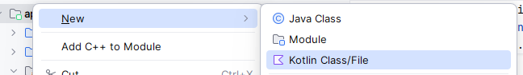
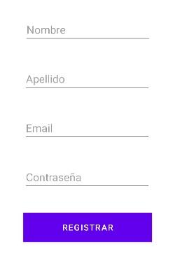
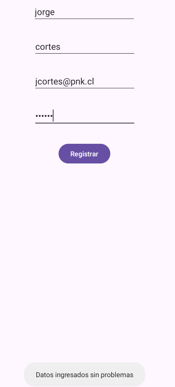
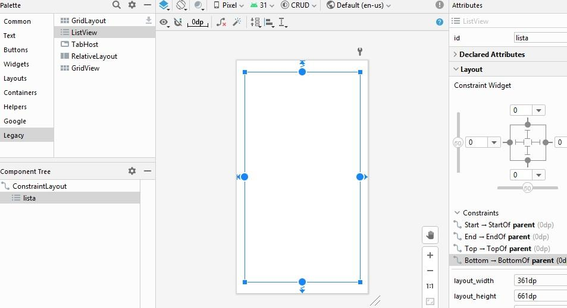
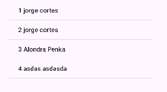
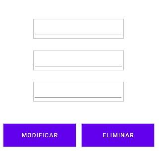
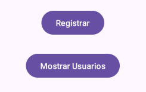
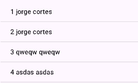
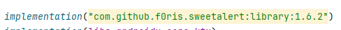
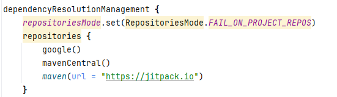

# Desarrollo de Aplicaciones Móviles en Android: Implementación CRUD SQLite


**Materia:** Aplicaciones Móviles  
**Tema:** Implementación CRUD con SQLite local en Android  

---

## 1. Conexión a la Base de Datos con `SQLiteOpenHelper`

Se crea una clase auxiliar que gestiona la creación y actualización de la base de datos local y su tabla `USUARIOS`:

```kotlin
class ConexionDbHelper(
    context: Context
) : SQLiteOpenHelper(context, DATABASE_NAME, null, DATABASE_VERSION) {

    private val sql = "CREATE TABLE USUARIOS (" +
            "ID INTEGER PRIMARY KEY AUTOINCREMENT, " +
            "NOMBRE TEXT, " +
            "APELLIDO TEXT, " +
            "EMAIL TEXT, " +
            "CLAVE TEXT)"

    override fun onCreate(db: SQLiteDatabase) {
        db.execSQL(sql)
    }

    override fun onUpgrade(db: SQLiteDatabase, oldVersion: Int, newVersion: Int) {
        db.execSQL("DROP TABLE IF EXISTS USUARIOS")
        onCreate(db)
    }

    companion object {
        private const val DATABASE_NAME = "APPSQLITE"
        private const val DATABASE_VERSION = 1
    }
}
```

---

## 2. Creación de la Activity de Registro

Se crea una nueva Activity llamada `Registro`:



En el `MainActivity` se programa un botón para abrir el formulario de registro:


```kotlin
val btn1: Button = findViewById(R.id.button)
btn1.setOnClickListener {
    val registro = Intent(this, Registro::class.java)
    startActivity(registro)
}
```

### 2.1 Layout de Registro
El formulario contiene los campos de entrada y el botón de guardar:



- `txtnombre`
- `txtapellido`
- `txtemail`
- `txtclave`
- `btn_registro`

### 2.2 Código para Guardar Usuarios en SQLite
```kotlin
lateinit var nombre: EditText
lateinit var apellido: EditText
lateinit var email: EditText
lateinit var clave: EditText
lateinit var btn_reg: Button

override fun onCreate(savedInstanceState: Bundle?) {
    super.onCreate(savedInstanceState)
    setContentView(R.layout.activity_registro)

    nombre = findViewById(R.id.txtnombre)
    apellido = findViewById(R.id.txtapellido)
    email = findViewById(R.id.txtemail)
    clave = findViewById(R.id.txtclave)
    btn_reg = findViewById(R.id.btn_registro)

    btn_reg.setOnClickListener {
        guardar(
            nombre.text.toString().trim(),
            apellido.text.toString().trim(),
            email.text.toString().trim(),
            clave.text.toString().trim()
        )
    }
}

fun guardar(nom: String, ape: String, mai: String, cla: String) {
    val helper = ConexionDbHelper(this)
    val db = helper.writableDatabase
    try {
        val datos = ContentValues().apply {
            put("NOMBRE", nom)
            put("APELLIDO", ape)
            put("EMAIL", mai)
            put("CLAVE", cla)
        }
        db.insert("USUARIOS", null, datos)
        Toast.makeText(this, "Datos ingresados sin problemas", Toast.LENGTH_LONG).show()

        val listado = Intent(this, Listado::class.java)
        startActivity(listado)
    } catch (e: Exception) {
        Toast.makeText(this, "Error: ${e.message}", Toast.LENGTH_LONG).show()
    } finally {
        db.close()
    }
}
```

---

## 3. Listado de Usuarios con `ListView`

Se crea una Activity llamada `Listado` con un componente `ListView` (`R.id.lista`):



### 3.1 Consulta de Usuarios (`SELECT`)
```kotlin
private lateinit var listado: ListView
private lateinit var listausuario: ArrayList<String>

private fun listaUsuario(): ArrayList<String> {
    val datos = ArrayList<String>()
    val helper = ConexionDbHelper(this)
    val db = helper.readableDatabase
    val sql = "SELECT * FROM USUARIOS"
    val c = db.rawQuery(sql, null)

    if (c.moveToFirst()) {
        do {
            val linea = "${c.getInt(0)} ${c.getString(1)} ${c.getString(2)}"
            datos.add(linea)
        } while (c.moveToNext())
    }
    c.close()
    db.close()
    return datos
}
```



### 3.2 Adaptar y Mostrar Datos
```kotlin
private fun CargarLista() {
    listausuario = listaUsuario()
    val adapter = ArrayAdapter(this, android.R.layout.simple_list_item_1, listausuario)
    listado.adapter = adapter
}

override fun onStart() {
    super.onStart()
    CargarLista() // Refresca los datos automáticamente al volver a la pantalla
}
```

Resultado visual del listado de usuarios:



---

## 4. Modificar y Eliminar Usuarios

Se crea la Activity `ModificarEliminar` para gestionar el registro seleccionado:



### 4.1 Enviar Datos con `Intent.putExtra()` desde el `ListView`
```kotlin
listado.onItemClickListener = AdapterView.OnItemClickListener { parent, view, position, id ->
    val item = listausuario[position]
    val datos = item.split(" ")

    if (datos.size >= 3) {
        val idusu = datos[0].toIntOrNull() ?: 0
        val nombre = datos[1]
        val apellido = datos[2]

        val intent = Intent(this@Listado, ModificarEliminar::class.java).apply {
            putExtra("Id", idusu)
            putExtra("Nombre", nombre)
            putExtra("Apellido", apellido)
        }
        startActivity(intent)
    }
}
```

### 4.2 Recepción de Parámetros en `ModificarEliminar`
```kotlin
val idusu = intent.getIntExtra("Id", 0)
val nombre = intent.getStringExtra("Nombre") ?: ""
val apellido = intent.getStringExtra("Apellido") ?: ""

id.setText(idusu.toString())
nom.setText(nombre)
ape.setText(apellido)
```



### 4.3 Métodos `modificar()` y `eliminar()`
```kotlin
private fun modificar(id: Int, nombre: String, apellido: String) {
    val helper = ConexionDbHelper(this)
    val db = helper.writableDatabase
    val sql = "UPDATE USUARIOS SET NOMBRE='$nombre', APELLIDO='$apellido' WHERE ID=$id"
    db.execSQL(sql)
    db.close()
}

private fun eliminar(id: Int) {
    val helper = ConexionDbHelper(this)
    val db = helper.writableDatabase
    val sql = "DELETE FROM USUARIOS WHERE ID=$id"
    db.execSQL(sql)
    db.close()
}
```

Acciones en los botones:
```kotlin
mod.setOnClickListener {
    modificar(idusu, nom.text.toString(), ape.text.toString())
    onBackPressedDispatcher.onBackPressed()
}

elim.setOnClickListener {
    eliminar(idusu)
    onBackPressedDispatcher.onBackPressed()
}
```

---

## 5. Integración con Librería `SweetAlert Dialog`

Para notificar campos incompletos y operaciones exitosas:

```kotlin
private fun mostrarAlertaCamposVacios() {
    SweetAlertDialog(this, SweetAlertDialog.WARNING_TYPE)
        .setTitleText("Campos incompletos")
        .setContentText("Por favor, complete todos los campos antes de continuar.")
        .setConfirmText("Aceptar")
        .setConfirmClickListener { dialog ->
            dialog.dismissWithAnimation()
        }
        .show()
}
```



### Configuración en Gradle
1. En `build.gradle (Module: app)`:
```groovy
implementation("com.github.f0ris.sweetalert:library:1.6.2")
```


2. Presionar **Sync Now**:


3. En `settings.gradle`:
```groovy
dependencyResolutionManagement {
    repositories {
        google()
        mavenCentral()
        maven { url = uri("https://jitpack.io") }
    }
}
```

