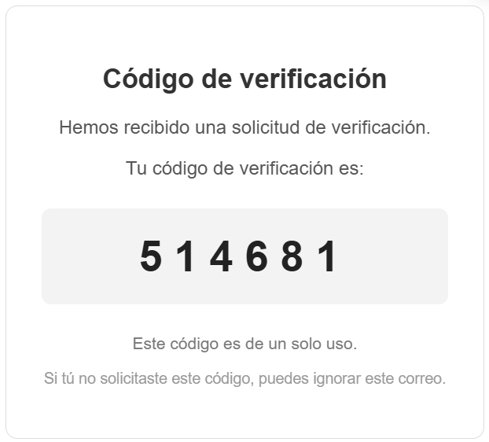
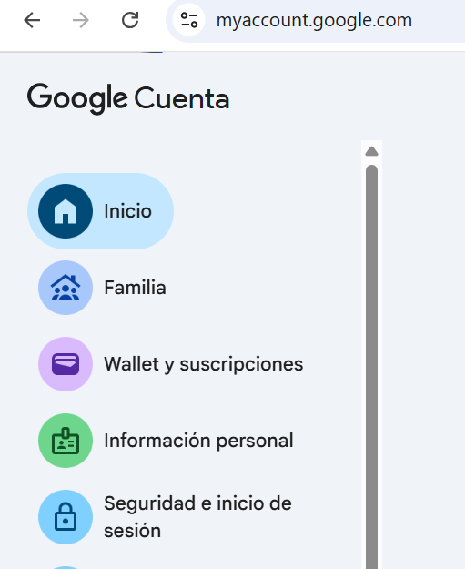
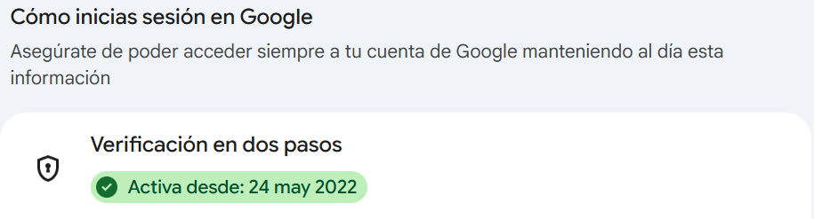
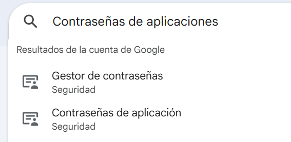
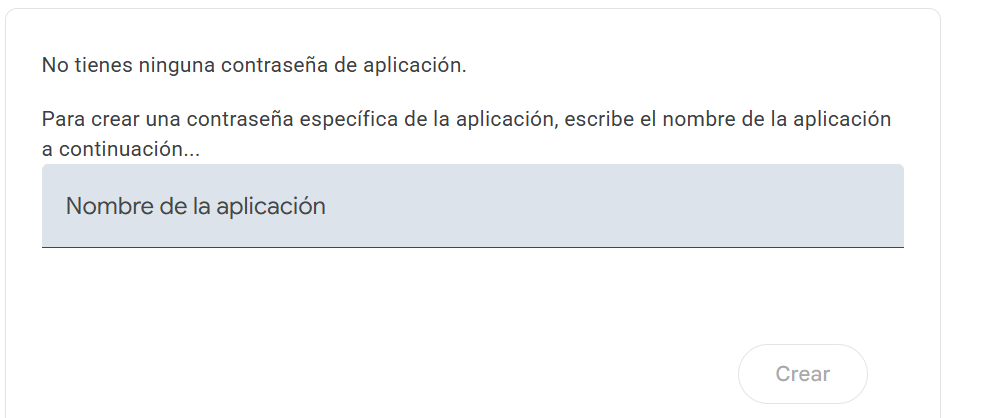
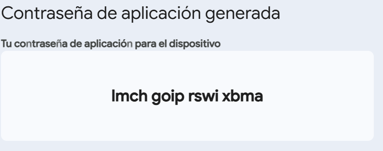
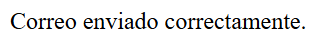
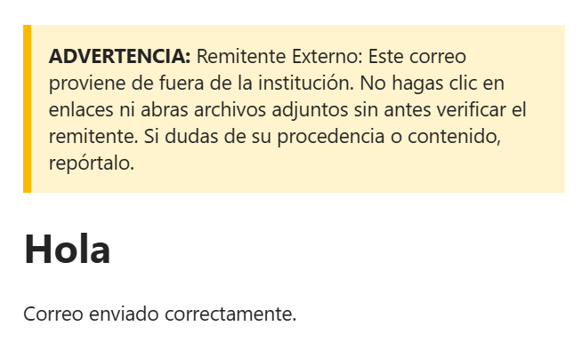
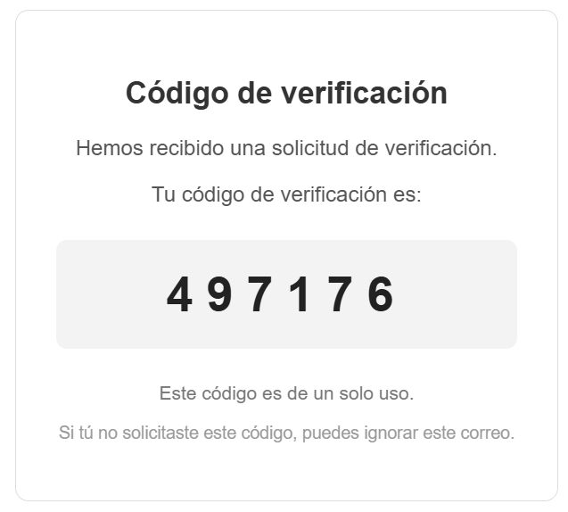

# Implementación de Librería PHPMailer: Recuperación de Contraseña



---

## 1. Instalación y Configuración Inicial en AWS

Antes de comenzar, se debe instalar **Git** en la instancia EC2 de AWS:

```bash
sudo yum install git -y
```

Luego, clonar el repositorio de la librería **PHPMailer** en el directorio web (por ejemplo `/var/www/html`):

```bash
git clone https://github.com/PHPMailer/PHPMailer.git
```

---

## 2. Configuración de Seguridad en Google (Gmail)

Para permitir que PHPMailer envíe correos desde una cuenta de Gmail, es obligatorio configurar una **Contraseña de Aplicación**.

### Paso 1: Activar Verificación en Dos Pasos
Ingresar a: `https://myaccount.google.com/security`




### Paso 2: Crear Contraseña de Aplicación
Ingresar a la sección de **Contraseñas de aplicaciones**:



Asignar un nombre identificativo para la aplicación (por ejemplo "App Movil IoT"):



Al presionar **Crear**, Google mostrará una clave de 16 caracteres:



> ⚠️ **Importante:** Copiar la clave de 16 caracteres generada sin los espacios (ejemplo: si Google muestra `abcd efgh ijkl mnop`, en PHP se ingresa `abcdefghijklmnop`).

---

## 3. Prueba Básica de Envío (`enviar.php`)

Crear un archivo `enviar.php`:

```php
<?php 
use PHPMailer\PHPMailer\PHPMailer; 
use PHPMailer\PHPMailer\Exception; 

require 'PHPMailer/src/Exception.php'; 
require 'PHPMailer/src/PHPMailer.php'; 
require 'PHPMailer/src/SMTP.php'; 

$mail = new PHPMailer(true); 

try { 
    $mail->isSMTP(); 
    $mail->Host       = 'smtp.gmail.com'; 
    $mail->SMTPAuth   = true; 
    $mail->Username   = 'tucorreo@gmail.com'; 
    $mail->Password   = 'TU_CONTRASEÑA_DE_APLICACION'; 
    $mail->SMTPSecure = PHPMailer::ENCRYPTION_STARTTLS; 
    $mail->Port       = 587; 

    $mail->setFrom('tucorreo@gmail.com', 'Mi Aplicación IoT'); 
    $mail->addAddress('destinatario@gmail.com'); 

    $mail->isHTML(true); 
    $mail->Subject = 'Prueba PHPMailer'; 
    $mail->Body    = '<h1>Hola</h1><p>Correo enviado correctamente.</p>'; 

    $mail->send(); 
    echo 'Correo enviado correctamente'; 
} catch (Exception $e) { 
    echo 'Error: ' . $mail->ErrorInfo; 
} 
?>
```

Al probar la URL en el navegador `http://<IP_INSTANCIA_AWS>/enviar.php`:




---

## 4. Script Completo de Recuperación con Código Aleatorio de 6 Dígitos

A continuación, el script completo que genera un código aleatorio de 6 dígitos con diseño HTML responsivo para recuperación de cuenta:

```php
<?php 
use PHPMailer\PHPMailer\PHPMailer; 
use PHPMailer\PHPMailer\Exception; 

require 'PHPMailer/src/Exception.php'; 
require 'PHPMailer/src/PHPMailer.php'; 
require 'PHPMailer/src/SMTP.php'; 

$mail = new PHPMailer(true); 

try { 
    // ========================================== 
    // 1. GENERAR CÓDIGO ALEATORIO DE 6 DÍGITOS 
    // ========================================== 
    $codigo = random_int(100000, 999999); 

    // ========================================== 
    // 2. CONFIGURACIÓN SMTP DE GMAIL 
    // ========================================== 
    $mail->isSMTP(); 
    $mail->Host       = 'smtp.gmail.com'; 
    $mail->SMTPAuth   = true; 
    $mail->Username   = 'jorge.cortes.gallardo@gmail.com'; // Correo remitente
    $mail->Password   = 'TU_NUEVA_CONTRASENA_DE_APLICACION'; // Contraseña de aplicación
    $mail->SMTPSecure = PHPMailer::ENCRYPTION_STARTTLS; 
    $mail->Port       = 587; 

    // ========================================== 
    // 3. REMITENTE Y DESTINATARIO 
    // ========================================== 
    $mail->setFrom('jorge.cortes.gallardo@gmail.com', 'Mi Aplicación IoT'); 
    $mail->addAddress('jorge.cortes16@inacapmail.cl'); // Correo destinatario

    // ========================================== 
    // 4. CONFIGURACIÓN Y CUERPO DEL CORREO HTML 
    // ========================================== 
    $mail->isHTML(true); 
    $mail->CharSet = 'UTF-8'; 
    $mail->Subject = 'Código de verificación'; 

    $mail->Body = ' 
        <div style=" 
            font-family: Arial, Helvetica, sans-serif; 
            max-width: 500px; 
            margin: 40px auto; 
            padding: 30px; 
            border: 1px solid #dddddd; 
            border-radius: 10px; 
            text-align: center; 
            background-color: #ffffff; 
        "> 
            <h2 style="color: #333333;">Código de verificación</h2> 
            <p style="color: #555555; font-size: 16px;"> 
                Hemos recibido una solicitud de verificación para restablecer tu contraseña. 
            </p> 
            <p style="color: #555555; font-size: 16px;"> 
                Tu código de verificación es: 
            </p> 
            <div style=" 
                margin: 25px 0; 
                padding: 20px; 
                background-color: #f3f3f3; 
                border-radius: 8px; 
                font-size: 36px; 
                font-weight: bold; 
                letter-spacing: 10px; 
                color: #222222; 
            "> 
                ' . $codigo . ' 
            </div> 
            <p style="color: #777777; font-size: 14px;"> 
                Este código es de un solo uso y vence en 1 minuto. 
            </p> 
            <p style="color: #999999; font-size: 13px;"> 
                Si no solicitaste este código, puedes ignorar este mensaje con seguridad. 
            </p> 
        </div> 
    '; 

    // ========================================== 
    // 5. ENVIAR CORREO 
    // ========================================== 
    $mail->send(); 

    echo 'Correo enviado correctamente.<br>'; 
    echo 'Código generado: ' . $codigo; 
} catch (Exception $e) { 
    echo 'Error al enviar el correo: ' . $mail->ErrorInfo; 
} 
?>
```

### 4.1 Resultado Visual en la Bandeja de Entrada
El destinatario recibe un correo formateado con el código de 6 dígitos:


