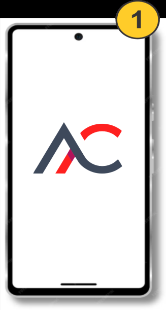
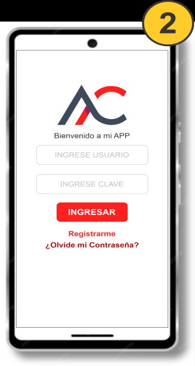
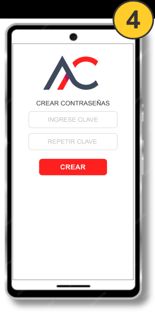
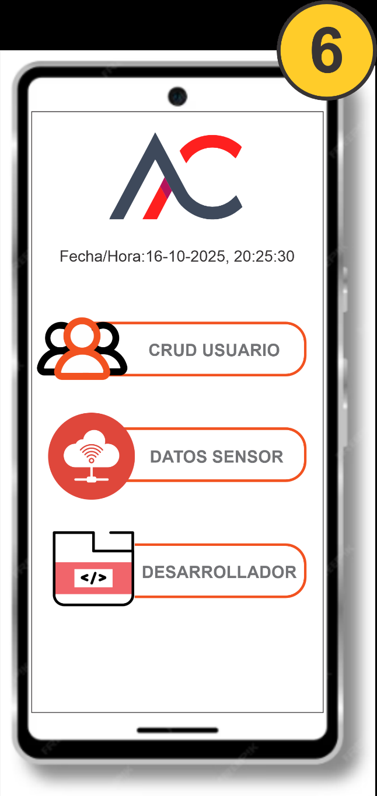
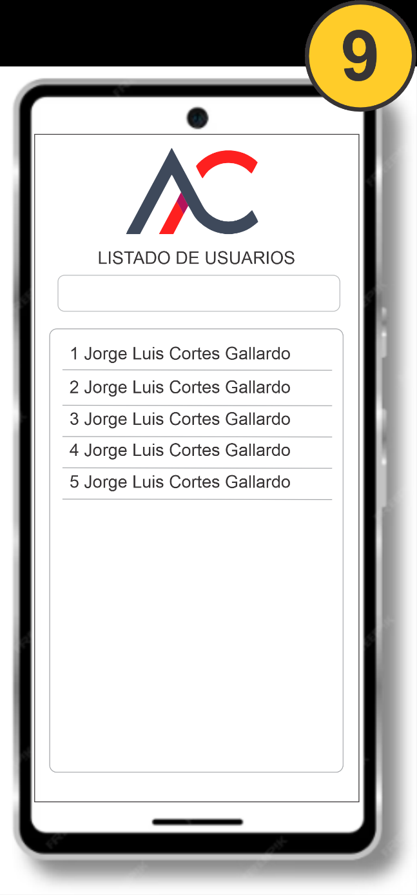
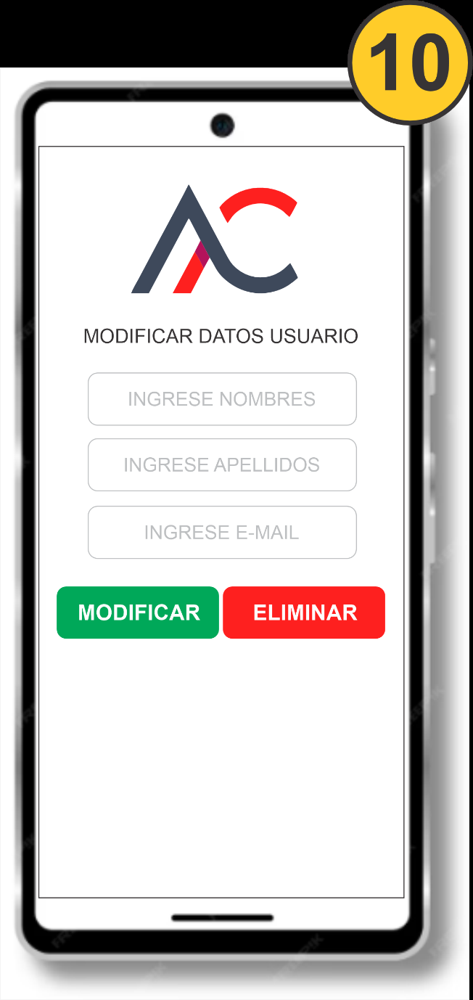
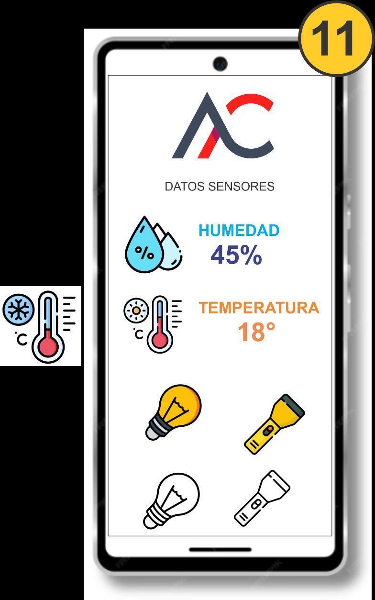
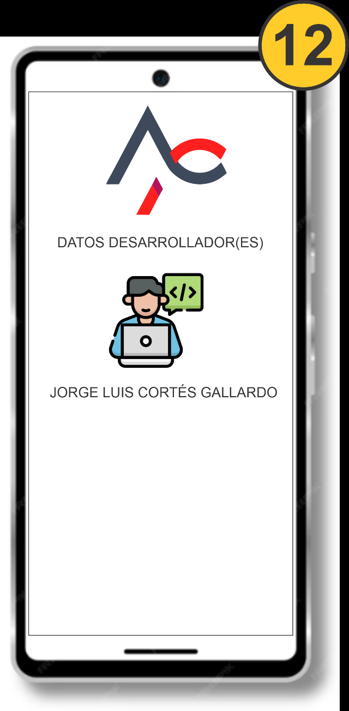
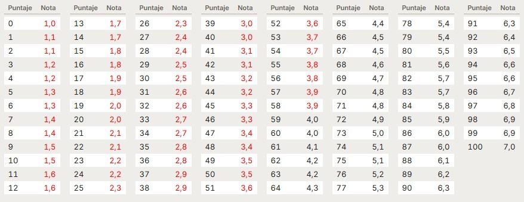

# Aplicaciones Móviles para IoT: Pauta de Requerimientos – Segunda Entrega

---

## 1. Información General e Importante

En esta segunda entrega se requiere implementar:
1. **Consumo de API** para registrar y visualizar los datos obtenidos desde sensores IoT.
2. **Operaciones CRUD completas** (consulta, ingreso, modificación y eliminación de datos).
3. **Persistencia dual**:
   - **MySQL en AWS:** Gestión de datos almacenados en la base de datos remota mediante consumo de API (usando MySQLi en el servidor).
   - **SQLite:** Implementación de operaciones CRUD sobre la base de datos local del teléfono.
4. **Modo Offline y Sincronización Automática (Desafío Principal):**
   - Detección de conectividad (Wi-Fi o datos móviles).
   - Funcionamiento sin conexión registrando cambios pendientes en SQLite.
   - Sincronización automática con MySQL en la nube al recuperar la conexión a Internet.
5. **Validación y Manejo de Errores:** Validaciones estrictas e información al usuario mediante SweetAlert.

> ⚠️ **IMPORTANTE:** La evaluación debe ser entregada y demostrada desde un **teléfono móvil físico**. No se aceptarán entregas realizadas desde emuladores.

---

## 2. Requerimientos Funcionales por Pantalla y Módulo

### 2.1 Login y Recuperación de Contraseña con PHPMailer
- **Login:** Autenticación de credenciales contra la base de datos remota MySQL en AWS vía API.
- **Recuperación de Contraseña:**
  - El usuario ingresa su correo electrónico registrado.
  - Se genera un código numérico aleatorio de 6 dígitos enviado por correo electrónico usando **PHPMailer**.
  - **Vigencia:** El código tendrá una vigencia estricta de **1 minuto**. Debe mostrarse un contador regresivo visible en pantalla.
  - Al solicitar la recuperación, la cuenta del usuario debe **bloquearse temporalmente**.
  - Si el usuario intenta iniciar sesión mientras la cuenta está bloqueada, debe mostrarse una alerta informativa.
  - Al validar el código dentro del minuto, se permite ingresar y confirmar la nueva contraseña.
  - Al guardar la nueva contraseña, la cuenta se **reactiva** y permite iniciar sesión normalmente.

#### Flujo de Pantallas de Recuperación:
| Paso 1: Ingreso de Correo | Paso 2: Notificación Envío | Paso 3: Código + Contador 1 Min | Paso 4: Nueva Contraseña |
|:---:|:---:|:---:|:---:|
|  |  |  |  |

#### Cuenta Bloqueada Temporalmente:

---

### 2.2 Menú Principal
Debe incluir tres opciones visibles como tarjetas/botones con icono y texto claro:
1. **CRUD de Usuarios**
2. **Ver datos de sensores**
3. **Datos del desarrollador**

---

### 2.3 Menú Gestión de Usuarios y Registro
Centraliza la administración de usuarios y presenta dos accesos claros:
- **Ingresar usuario:** Abre el formulario de registro.
- **Listar usuarios:** Muestra la tabla / listado de usuarios.

#### Registro de Usuario:
- Al registrar, verificar en MySQL que el nombre de usuario o correo no estén previamente registrados.
- Si ya existe, impedir el registro y mostrar mensaje explicativo con SweetAlert.
- Mantener las validaciones de robustez de contraseña (mínimo 8 caracteres, mayúscula, minúscula, número y carácter especial).
- Una vez registrado, notificar y retornar al menú de gestión de usuarios.

---

### 2.4 Listar Usuarios, Modificar y Eliminar (CRUD)
- **Listado:** Muestra tabla con nombres y apellidos (opcional correo).
- **Buscador:** Permite filtrar en tiempo real por nombres o apellidos, insensible a mayúsculas, minúsculas y acentos.
- **Edición:** Al pulsar sobre un usuario se abre la vista para modificar nombres, apellidos y correo.
- **Validaciones:**
  - Campos obligatorios no vacíos.
  - Nombres y apellidos solo admiten letras y espacios (incluye tildes y ñ).
  - Correo con formato válido y no duplicado.
- **Eliminación:** Requiere diálogo previo de confirmación con SweetAlert.
- Las operaciones se ejecutan sobre MySQL mediante consumo de API PHP.

| Listado de Usuarios con Buscador | Modificar y Eliminar Usuario |
|:---:|:---:|
|  |  |

---

### 2.5 Monitoreo de Sensores IoT y Hardware
- **Consumo de API:** Consumir datos de temperatura y humedad en tiempo real desde `https://www.pnk.cl/muestra_datos.php`.
- **Actualización periódica:** La fecha/hora y lecturas deben refrescarse periódicamente (por ejemplo cada 1 segundo con `Handler`).
- **Control de Linterna del Dispositivo:**
  - Al presionar la imagen de la linterna, encender o apagar la linterna física del dispositivo.
  - La imagen debe actualizarse entre encendida y apagada según el estado real.
- **Ampolleta Interactiva (Simulación Visual):**
  - Alterna entre ampolleta encendida y apagada al hacer clic. Es exclusivamente visual.

---

### 2.6 Datos del Desarrollador(es)
Vista de solo lectura que presenta a los estudiantes desarrolladores en tarjetas/lista con:
- Foto o Avatar
- Nombres y Apellidos
- Rol (Frontend / Backend / QA / PM)
- Correo institucional
- Institución, Carrera y Sección
- Enlaces funcionales a GitHub, LinkedIn o portafolio

---

### 2.7 Desafío: Modo Offline y Sincronización Automática con SQLite y MySQL

1. **Detección de conectividad:** Detectar cuando se pierde el acceso a Internet (Wi-Fi o datos) y cambiar inmediatamente a modo local SQLite sin interrumpir la experiencia.
2. **Operaciones locales:** Permitir consultar, agregar, editar y eliminar usuarios en SQLite localmente.
3. **Registro de cambios pendientes:** Marcar internamente qué operaciones están pendientes de sincronizar.
4. **Sincronización automática:** En cuanto se restablece la conexión a Internet, sincronizar automáticamente los cambios con la base de datos MySQL en la nube.
5. **Integridad:** Evitar duplicación o pérdida de datos. Solo marcar como sincronizado tras la confirmación exitosa de la API remota.
6. **Feedback visual:** Informar al usuario en todo momento (modo offline, cambios pendientes y sincronización completada).

---

## 3. Criterios de Evaluación y Escala de Calificaciones

| N.º | Criterio | Indicadores para obtener el puntaje máximo | Puntaje |
|:---:|---|---|:---:|
| **1** | Inicio de sesión | Valida las credenciales contra MySQL mediante la API, permite acceder con una cuenta activa y rechaza credenciales incorrectas o cuentas bloqueadas. | **8** |
| **2** | Recuperación de contraseña | Envía un código aleatorio mediante PHPMailer; muestra la cuenta regresiva de un minuto; rechaza códigos incorrectos o vencidos; permite solicitar otro código; bloquea la cuenta durante la recuperación y la reactiva después de guardar la nueva contraseña. | **12** |
| **3** | Registro y validaciones de usuarios | Registra usuarios en MySQL mediante la API, impide duplicados de nombre de usuario y correo, mantiene las validaciones de la primera entrega y confirma el registro. Desde gestión de usuarios, retorna al menú correspondiente. | **8** |
| **4** | Consulta, modificación y eliminación de usuarios | Lista usuarios desde MySQL mediante API y utiliza MySQLi en el servidor. Filtra por nombres y apellidos sin distinguir mayúsculas ni acentos. Permite modificar y eliminar, aplica las validaciones solicitadas y utiliza SweetAlert para las notificaciones y la confirmación de eliminación. | **12** |
| **5** | Consumo y visualización de datos IoT | Consulta la API de www.pnk.cl, muestra correctamente las lecturas recibidas e informa los errores de consulta sin cerrar inesperadamente la aplicación. | **8** |
| **6** | Linterna y ampolleta | Enciende y apaga la linterna real del teléfono y actualiza su imagen según el estado. La ampolleta alterna únicamente su imagen, sin activar dispositivos físicos. | **4** |
| **7** | Menús y navegación | Presenta los tres accesos del menú principal y las opciones de ingreso y listado del menú de usuarios. Los accesos y retornos funcionan correctamente. | **4** |
| **8** | Datos de los desarrolladores | Muestra una vista de solo lectura con foto o avatar, nombres, apellidos, rol, correo institucional, institución, carrera, sección y enlaces solicitados. | **4** |
| **9** | Detección de conectividad | Detecta la pérdida y recuperación del acceso a Internet, tanto por Wi-Fi como por datos móviles, y cambia al funcionamiento local sin interrumpir el uso de la aplicación. | **8** |
| **10** | Operaciones locales con SQLite | Permite consultar, ingresar, modificar y eliminar los registros disponibles localmente sin conexión. Los cambios persisten después de cerrar y volver a abrir la aplicación. | **8** |
| **11** | Registro de cambios pendientes y estados | Identifica y conserva los cambios pendientes de sincronización. Informa claramente el funcionamiento sin conexión, la existencia de cambios pendientes y la sincronización completada. | **8** |
| **12** | Sincronización automática con MySQL | Al recuperar Internet, envía automáticamente las inserciones, modificaciones y eliminaciones pendientes mediante la API. Los resultados se reflejan correctamente en MySQL. | **8** |
| **13** | Integridad y recuperación ante fallos | Evita pérdidas y duplicaciones. Marca los cambios como sincronizados únicamente después de la confirmación del servidor. Si falla el envío, conserva los pendientes y permite reintentar sin duplicar operaciones. | **8** |
| | **TOTAL DE LA EVALUACIÓN** | | **100** |

### Escala de Notas:

